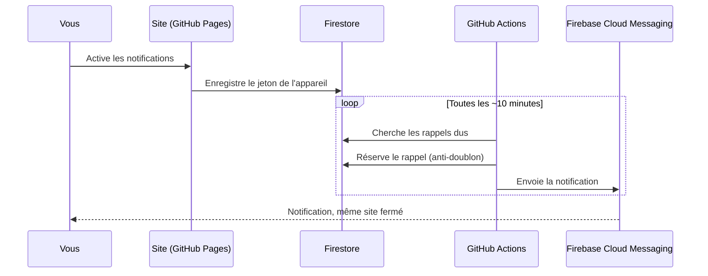

<div align="center">

# Badge Reminder


**Ne ratez plus votre prochain badgeage.**
Un compte à rebours simple, des rappels qui arrivent même quand le site est fermé.

<br />

[](https://timlerider.github.io/badge-reminder/)


</div>

---

## ✨ En un coup d'œil

Badge Reminder est un outil **personnel et indépendant** : il calcule, à partir de la date de votre dernier badgeage et du délai que vous choisissez, le nombre de jours qu'il vous reste. **Aucune connexion à un système externe** : tout repose sur les dates et délais que vous saisissez.

| | Fonctionnalité |
|---|---|
| 👤 | **Comptes personnels** (e-mail + mot de passe), session mémorisée, données retrouvées sur tous vos appareils |
| 🏷️ | **Plusieurs badges** par compte, chacun avec sa date, son délai et ses propres rappels |
| ⏳ | **Compteur fiable** calculé en jours calendaires (insensible aux changements d'heure) |
| 🎨 | **Couleurs dynamiques** et barre de progression, avec un libellé texte pour ne pas dépendre de la couleur seule |
| ✅ | Bouton **« J'ai badgé aujourd'hui »** : remise à zéro du compteur et du cycle de rappels |
| 🔔 | **Rappels personnalisables** : heure, fuseau horaire, jours autorisés, chaque seuil activable séparément |
| 📲 | **Vraies notifications push**, même site fermé |
| 🌗 | Thème **clair / sombre**, interface responsive, navigation au clavier, animations réduites si demandé |
| 📦 | **Export** de vos données en JSON et **suppression** complète du compte |

### Les couleurs du compteur

| Jours restants | État | Couleur |
|---|---|---|
| Plus de 21 | Large marge | 🟢 Vert |
| 15 à 21 | Pas de souci | 🔵 Turquoise |
| 8 à 14 | À surveiller | 🟡 Jaune |
| 4 à 7 | Bientôt | 🟠 Orange |
| 1 à 3 | Urgent | 🔴 Rouge |
| Échéance atteinte ou dépassée | Échéance atteinte | 🟥 Rouge foncé |

Le compteur n'affiche jamais de nombre négatif : une échéance dépassée devient « Échéance dépassée de X jours ».

### Les rappels par défaut

Chaque seuil peut être activé ou désactivé, badge par badge. Un même rappel n'est jamais envoyé deux fois pour le même badge et le même cycle.

| Temps restant | Message |
|---|---|
| 42 jours | Votre nouveau cycle de badgeage commence. |
| 28 jours | Il vous reste 4 semaines avant votre échéance estimée. |
| 21 jours | Il vous reste 3 semaines avant votre échéance estimée. |
| 14 jours | Il vous reste 2 semaines avant votre échéance estimée. |
| 7 jours | Attention, il vous reste une semaine avant votre échéance estimée. |
| 3 jours | Attention, il vous reste seulement 3 jours ! |
| 2 jours | Il vous reste 2 jours avant votre échéance estimée. |
| 1 jour | Dernier jour avant votre échéance estimée. |
| Jour J | Votre échéance estimée est aujourd'hui. |

> Le délai de 42 jours est une **valeur par défaut configurable** (14, 21, 28, 35, 42 ou durée personnalisée). Vérifiez le délai réellement applicable à votre situation.

---

## 🧩 Comment ça marche

GitHub Pages ne peut pas exécuter de code serveur : l'envoi des rappels est donc confié à un script lancé régulièrement par GitHub Actions.



| Brique | Rôle | Offre |
|---|---|---|
| **GitHub Pages** | Héberge le site statique (React + Vite) | gratuit |
| **GitHub Actions** | Déploiement + planificateur de rappels (cron) | gratuit (dépôt **public**) |
| **Firebase Authentication** | Comptes e-mail / mot de passe, sessions | Spark (gratuit) |
| **Cloud Firestore** | Données privées de chaque utilisateur | Spark (gratuit) |
| **Firebase Cloud Messaging** | Envoi des notifications push Web | gratuit |

- **Cloud Functions n'est pas utilisé** : il exige le forfait payant Blaze. Le planificateur est un script Node (`scripts/send-reminders.mjs`) qui utilise le SDK Firebase Admin.
- **Aucune facturation n'est activée** : restez sur Spark et n'ajoutez aucune carte bancaire.
- Les messages push sont envoyés en « data-only » : le service worker (`public/sw.js`) les affiche lui-même, sans clé ni SDK.

---

## ⚠️ Limites à connaître

| Limite | Détail |
|---|---|
| **Pas de ponctualité à la minute** | Le cron tourne toutes les 10 min et GitHub peut le retarder de plusieurs minutes. Un rappel part « vers » l'heure choisie. |
| **Dépôt public** | Nécessaire pour des minutes Actions illimitées. En dépôt privé (2 000 min/mois), passez le cron à `'5 * * * *'` (toutes les heures). |
| **Cron inactif** | GitHub désactive les workflows planifiés d'un dépôt public sans activité pendant 60 jours. Réactivez-le dans *Actions* ou poussez un petit commit. |
| **Test push différé** | Sans serveur, le navigateur ne peut pas déclencher FCM lui-même : le « Test push réel » est traité au prochain passage du planificateur. Le « Test local » est immédiat mais ne passe pas par FCM. |
| **Rappel manqué = non reporté** | Si le planificateur est en panne une journée entière, le rappel de ce jour est perdu. Un jour non autorisé n'est pas reporté non plus. |
| **Nouveau cycle** | Un badgeage, ou la modification de la date ou du délai, repart sur un nouveau cycle de rappels. |
| **iPhone / iPad** | iOS 16.4 minimum **et** site ajouté à l'écran d'accueil (Partager → Sur l'écran d'accueil). |
| **Quotas Firestore (Spark)** | Environ 50 000 lectures et 20 000 écritures par jour (à revérifier sur la page de tarification Firebase). Estimation : 144 passages × 3 utilisateurs × ~5 lectures ≈ 2 200 lectures/jour. Pour beaucoup d'utilisateurs, espacez le cron. |

---

## 🚀 Installation

> Durée : environ 30 minutes, sans carte bancaire. Prérequis : un compte GitHub, un compte Google et **Node.js 22 ou plus** ([nodejs.org](https://nodejs.org)).

### Résumé en 6 étapes

1. Créer le dépôt GitHub **public** `badge-reminder`.
2. Créer un projet Firebase (Authentication, Firestore, règles, application web, clé VAPID).
3. Remplir `.env.local` pour tester en local.
4. Ajouter les 7 secrets dans GitHub Actions.
5. Activer GitHub Pages (source : *GitHub Actions*).
6. Pousser le code : le site se déploie sur `https://timlerider.github.io/badge-reminder/`.

<details>
<summary><strong>📂 Étapes 1 à 5 : dépôt et poste local</strong></summary>

1. **Créer le dépôt** : sur GitHub, *New repository* → nom exact **`badge-reminder`**, visibilité **Public**, sans README ni `.gitignore`. Si vous changez le nom, adaptez `VITE_BASE` ou `vite.config.js`.
2. **Installer Node.js** (version 22 ou plus), puis vérifier avec `node -v`.
3. **Récupérer le projet** : décompressez l'archive, puis dans le dossier :
   ```bash
   git init -b main
   git add .
   git commit -m "Première version"
   git remote add origin https://github.com/TimLeRider/badge-reminder.git
   ```
   Ne poussez pas tout de suite : configurez d'abord les secrets (étape 13).
4. **Installer les dépendances** : `npm install`
5. **Lancer en local** (après avoir créé `.env.local`, étape 11) : `npm run dev`, puis ouvrir l'adresse affichée (de la forme `http://localhost:5173/badge-reminder/`).

</details>

<details>
<summary><strong>🔥 Étapes 6 à 12 : Firebase</strong></summary>

6. **Créer le projet** : [console.firebase.google.com](https://console.firebase.google.com) → *Ajouter un projet* → désactivez Google Analytics. Restez sur le forfait **Spark**.
7. **Activer Authentication** : *Build → Authentication → Commencer → Sign-in method → E-mail/Mot de passe → Activer*. Dans *Settings → Authorized domains*, ajoutez `timlerider.github.io`.
8. **Activer Firestore** : *Build → Firestore Database → Créer une base de données* → **mode production** → région européenne (ex. `eur3`).
9. **Publier les règles de sécurité** : *Firestore → Règles* → remplacez tout le contenu par celui de `firestore.rules` → **Publier**. La première ligne doit être `rules_version = '2';` (ne collez pas le nom du fichier).
   Alternative CLI : `npx firebase-tools login` puis `npx firebase-tools deploy --only firestore:rules --project VOTRE_PROJECT_ID`.
   Contrôlez avec le *Simulateur de règles* : lire `users/AUTRE_UID` avec un autre uid doit être **refusé**.
10. **Vérifier FCM** : *Paramètres du projet → Cloud Messaging* : l'API *Firebase Cloud Messaging API (V1)* doit être activée (c'est le cas par défaut).
11. **Application web et clé VAPID** :
    - *Paramètres du projet → Général → Vos applications → Web (`</>`)* → nom `badge-reminder`, **sans** Firebase Hosting → copiez la configuration.
    - *Paramètres du projet → Cloud Messaging → Configuration Web → Certificats Web Push → Générer une paire de clés* → copiez la **clé publique**.
    - Copiez `.env.example` en `.env.local` (sous Windows : `copy .env.example .env.local`) et remplissez les 6 valeurs :

      | Dans la config Firebase | Variable |
      |---|---|
      | `apiKey` | `VITE_FIREBASE_API_KEY` |
      | `authDomain` | `VITE_FIREBASE_AUTH_DOMAIN` |
      | `projectId` | `VITE_FIREBASE_PROJECT_ID` |
      | `messagingSenderId` | `VITE_FIREBASE_MESSAGING_SENDER_ID` |
      | `appId` | `VITE_FIREBASE_APP_ID` |
      | clé publique VAPID | `VITE_FIREBASE_VAPID_KEY` |

      Recopiez ce qui est **entre les guillemets**, sans guillemets ni virgule. `storageBucket` n'est pas utilisé. Ce fichier est ignoré par Git.
12. **Service worker** : rien à configurer. `public/sw.js` est servi sous `/badge-reminder/sw.js` et enregistré automatiquement. Il ne contient aucune clé.

</details>

<details>
<summary><strong>🐙 Étapes 13 à 18 : GitHub</strong></summary>

13. **Secrets GitHub Actions** : dépôt → *Settings → Secrets and variables → Actions → New repository secret*. Créez **7 secrets** :
    - les 6 `VITE_FIREBASE_*` (mêmes valeurs que `.env.local`) ;
    - **`FIREBASE_SERVICE_ACCOUNT`** : *Firebase → Paramètres → Comptes de service → Générer une nouvelle clé privée*, puis collez **tout le contenu du fichier JSON** dans le secret. **Supprimez ensuite le fichier téléchargé** de votre ordinateur et ne le mettez jamais dans le dépôt.
14. **Activer GitHub Pages** : *Settings → Pages → Build and deployment → Source : **GitHub Actions***. Laissez « Custom domain » vide.
15. **Premier déploiement** : `git push -u origin main`. Suivez l'onglet *Actions* (workflow « Déploiement GitHub Pages ») : tests, construction, publication.
16. **Tester une notification** : ouvrez le site, créez un compte et un badge, page *Notifications* → activez l'interrupteur (acceptez la demande du navigateur) → *Test local*, puis *Test push réel*. Pour ne pas attendre le cron : *Actions → Rappels de badgeage → Run workflow* (case *Simulation* décochée).
17. **Vérifier la sauvegarde** : dans Firestore, vous devez voir `users/{uid}`, `users/{uid}/badges/...` et `users/{uid}/notificationTokens/...`. Reconnectez-vous depuis un autre navigateur : vos badges réapparaissent.
18. **Mettre à jour le site** : modifiez le code, puis `git add . && git commit -m "…" && git push`. Le déploiement est automatique.
    Pour simuler le planificateur en local : `FIREBASE_SERVICE_ACCOUNT="$(cat cle.json)" npm run reminders:dry` (`cle.json` ne doit jamais être commité : le `.gitignore` bloque `*-firebase-adminsdk-*.json` et `service-account*.json`).

</details>

---

## 🛠️ Dépannage

| Symptôme | Cause et solution |
|---|---|
| Firestore : `mismatched input 'firestore' expecting ...` à la ligne 1 | Le nom du fichier s'est collé avec les règles. Videz l'éditeur et collez uniquement le contenu, qui commence par `rules_version = '2';`. |
| `git push` : `non-fast-forward` / `rejected` | Le dépôt distant contient des modifications absentes de votre PC. Faites `git pull --rebase origin main`, puis `git push`. En cas de `CONFLICT`, ne forcez rien. |
| Workflow : `Cannot read properties of undefined (reading 'cert')` | Ancien import de `firebase-admin`. Utilisez les imports modulaires `firebase-admin/app`, `firebase-admin/firestore` et `firebase-admin/messaging` (déjà le cas dans la version actuelle de `scripts/send-reminders.mjs`). |
| Workflow : `Cannot find module '@google-cloud/firestore'` | `firebase-admin` exige Node 22 ou plus : les workflows doivent utiliser `node-version: 22`. |
| Workflow : `n'est pas un JSON valide` | Le secret `FIREBASE_SERVICE_ACCOUNT` est mal collé : recollez **tout** le contenu du JSON, de `{` à `}`. |
| Workflow : `Variable FIREBASE_SERVICE_ACCOUNT absente` | Le secret n'existe pas, ou son nom est mal orthographié. |
| Pas de notification reçue | Vérifiez l'autorisation du navigateur, que l'interrupteur est activé, et (iPhone) que le site est installé sur l'écran d'accueil. Relancez le workflow sans « Simulation ». |
| Message « Configuration Firebase manquante » | Les variables `VITE_FIREBASE_*` sont absentes (`.env.local` en local, secrets GitHub en ligne). |

---

## 🔒 Sécurité

- Mots de passe gérés **uniquement** par Firebase Authentication : l'application ne les stocke jamais.
- Session persistante via Firebase (`browserLocalPersistence`) ; « Se souvenir de moi » décoché = session limitée à l'onglet.
- **Règles Firestore** : refus par défaut, accès limité au propriétaire (`request.auth.uid == uid`), champs et types validés, historique des rappels en écriture interdite côté client, une seule demande de test push en attente à la fois.
- Aucune clé privée dans le navigateur ni dans le dépôt. La configuration web Firebase (`VITE_FIREBASE_*`) **n'est pas un secret** ; la clé de compte de service, elle, l'est et ne vit que dans les secrets GitHub.
- Le workflow de rappels n'a **pas** de déclencheur `pull_request` (les secrets ne sont jamais exposés à du code externe) et ses permissions sont réduites à `contents: read`.
- L'anti-doublon repose sur une écriture Firestore atomique `create()` d'un document `cycle_seuil` avant chaque envoi.

---

## 🗂️ Structure du projet

```text
src/lib/dates.js             calculs calendaires (UTC, insensibles à l'heure d'été), niveaux de couleur
src/lib/reminders.js         seuils 42/28/21/14/7/3/2/1/0, messages, rappels dus (partagé avec le planificateur)
src/lib/actions.js           Auth + Firestore (badges, préférences, export, suppression du compte)
src/lib/push.js              FCM : permission, jeton, test local
src/pages/                   accueil, inscription, connexion, assistant, tableau de bord, badges,
                             notifications, paramètres, profil
public/sw.js                 service worker Web Push
scripts/send-reminders.mjs   planificateur (Firebase Admin)
firestore.rules              règles de sécurité
.github/workflows/           deploy.yml (Pages) et reminders.yml (cron)
```

---

## ✅ Tests

**Automatisés** (`npm test`) : 26 tests unitaires couvrant le délai de 42 jours, les délais personnalisés, le jour même, l'échéance atteinte ou dépassée (jamais de nombre négatif), la progression plafonnée à 100 %, les seuils de couleur (22/21/15/14/8/7/4/3/1/0 jours), le changement d'heure du 29 mars 2026, les années bissextiles, les fuseaux horaires, l'heure et les jours autorisés, l'activation individuelle des seuils et la liste des prochains rappels.

**À valider avec votre projet Firebase et vos appareils :**

- [ ] Création de compte, adresse déjà utilisée, connexion, déconnexion, mot de passe oublié, session après fermeture du navigateur, connexion depuis un autre appareil
- [ ] Création d'un badge, « J'ai badgé aujourd'hui », modification de la date, plusieurs badges indépendants, suppression d'un badge
- [ ] Règles Firestore : un utilisateur A ne peut ni lire ni écrire les données de B ; un client ne peut pas écrire dans `reminders`
- [ ] Autorisation accordée puis refusée ; test local ; test push réel ; réception site ouvert puis fermé (Android/Chrome, ordinateur, iPhone installé)
- [ ] Workflow lancé à la main en simulation puis en réel ; aucun doublon au second passage ; jeton invalide supprimé
- [ ] Rappel à la bonne heure selon le fuseau horaire et les jours autorisés ; nouveau cycle après badgeage
- [ ] Export JSON (sans secret) ; suppression du compte (mot de passe demandé, données et compte supprimés)
- [ ] Onglet *Actions* : déploiements verts ; console du navigateur sans erreur critique

---

<div align="center">

Outil personnel et indépendant · Le calcul repose uniquement sur les dates et délais que vous renseignez.

</div>
